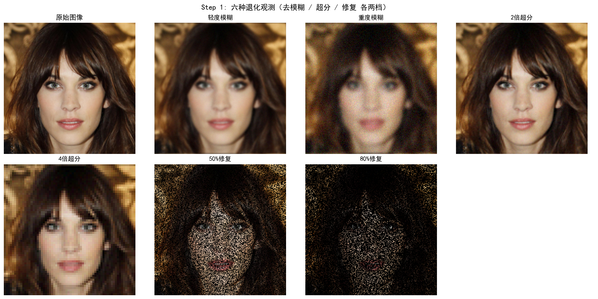
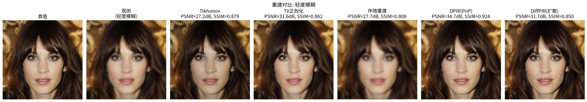
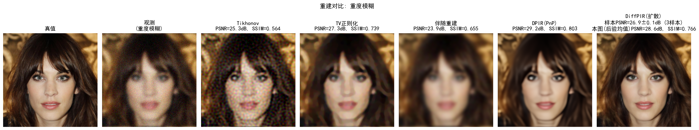
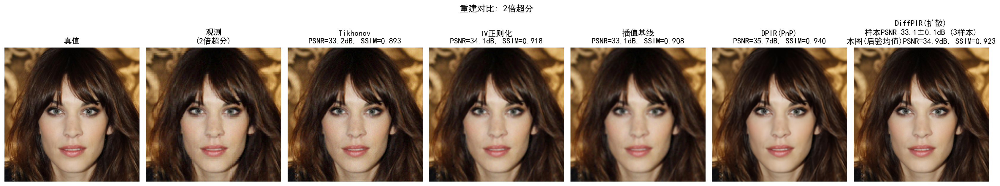
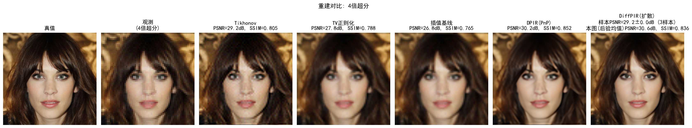
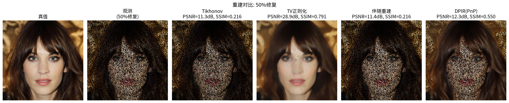
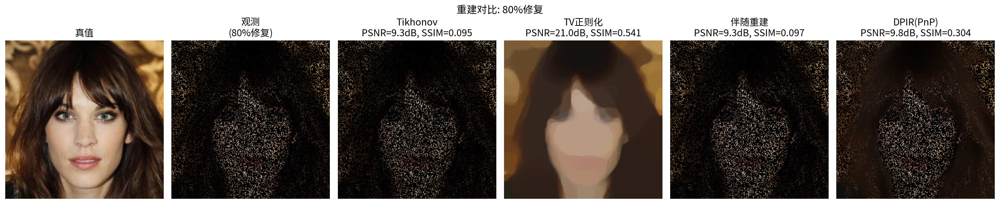
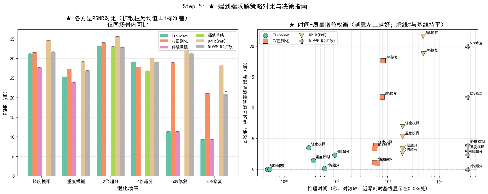

# 18.4 端到端实战：把管子接起来，真跑三个逆问题

> 前面三节你造了引擎（18.2 的 $A$）、选了策略（18.3 的方法谱）。现在到了"毕业设计答辩"环节——把它们接成一根完整的管子，真跑一遍。先问你一个反直觉的问题：**同样一张被糊掉、又加了噪的图，TV 正则化不到 1 秒出结果，扩散模型要慢上十几倍，那扩散到底贵得有没有道理？** 这一节用三个递进项目（去模糊、超分、修复）把"贵得值不值"用数字摊开。结论先剧透：**"退化越重、扩散越强"这个流行说法在本实验里并没有成立**——决定排序的不是退化有多重，而是退化属于哪一类（缺纹理还是缺像素），以及你给自己的方法调了什么参数。

读完这节，你应该能：
- 把 18.2–18.3 的管线和代码真正跑通"模糊→清晰"；
- 看懂"方法强弱"不是口号，而是 PSNR/耗时表上的硬数字，且随时可能被参数改写；
- 亲手验证：方法强 ≠ 永远强，**退化类型 + 参数配置**共同决定一切。

## 18.4.1 项目 1：图像去模糊

### 问题定义（这就是第 1 章的 $y=Ax$）

去模糊是最经典的线性逆问题，前向模型：

$$y = Kx + \epsilon, \quad \epsilon \sim \mathcal{N}(0,\sigma^2 I)$$

为什么从去模糊开刀？因为它最"朴素"——模糊核 $K$ 一卷积、噪声一加，就是你的观测 $x$ 变 $y$ 的全过程，最能看清管线的每一步。我们看两档难度：
- **轻度**：小模糊（$\sigma_K=1.5$）+ 低噪（$\sigma=0.01$）
- **重度**：大模糊（$\sigma_K=3.0$）+ 高噪（$\sigma=0.05$）

### 步骤 1：定义前向算子（回到 18.2）

```python
import torch, deepinv as dinv
device = dinv.utils.get_freer_gpu() if torch.cuda.is_available() else "cpu"
x_true = dinv.utils.load_example("celeba_example.jpg", img_size=(256, 256))

# 自定义模糊核（也可直接用 dinv.physics.blur.gaussian_blur）
kernel = dinv.physics.blur.gaussian_blur(sigma=(3.0, 3.0))   # 重度档
physics = dinv.physics.Blur(img_size=(3, 256, 256), filter=kernel)
physics.set_noise_model(dinv.physics.GaussianNoise(sigma=0.05))
y = physics(x_true)   # 制造一次观测
```

### 步骤 2–3：选策略 + 加载去噪器（回到 18.1 的方法谱系）

```python
denoiser_drunet = dinv.models.DRUNet().to(device)    # PnP 用
denoiser_diffunet = dinv.models.DiffUNet().to(device)  # 扩散用
```

### 步骤 4：三种方法同台打擂（对应第 3 / 5 / 13 章）

**优化——TV 正则化**（第 3 章 3.5 节，Chambolle-Pock 解）：

$$\hat{x} = \arg\min_x \frac{1}{2\sigma^2}\|Kx - y\|^2 + \lambda\|Dx\|_1$$

```python
from deepinv.optim import ADMM
model_tv = ADMM(...)   # TV 正则化配置
x_tv = model_tv(y, physics)
```

**PnP——DPIR**（第 5 章的去噪器即先验）：
```python
from deepinv.optim import DPIR
model_dpir = DPIR(denoiser=denoiser_drunet,
                  params={"stepsize":1.0, "sigma":[0.1,0.05,0.025,0.01]})
x_dpir = model_dpir(y, physics)
```

**扩散——DiffPIR**（第 13 章条件扩散采样）：
```python
from deepinv.sampling import DiffPIR
model_diffpir = DiffPIR(denoiser=denoiser_diffunet, data_fidelity="L2",
                        params={"step_size":1.0})
x_diffpir = model_diffpir(y, physics)
```

> 说明：以上三段代码的参数写法是教学示意，突出"每类方法只换求解器、管线其余不动"；`DPIR` 与 `DiffPIR` 在 deepinv 中的实际构造参数，以 18.3.2 和 18.3.3 的接口说明为准。

### 步骤 5：结果对比（先猜后揭）

**先猜一下**：重度模糊+高噪下，TV、DPIR、DiffPIR 三者 PSNR 谁高？差距会有多大？
> 揭晓（来自 18.4-1 实验实测，见本节末尾）：重度模糊下 **DPIR≈29.2 dB 最高**，TV≈27.3 dB 与 DiffPIR≈27.1 dB 紧随其后；轻度模糊下 **DPIR≈34.7 dB 领先**，DiffPIR≈31.7 dB、TV≈31.6 dB 次之，Tikhonov≈27.2 dB 垫底。而且 DPIR 只花 0.2–0.35 s，比 DiffPIR 快约 30 倍却更准。

| 方法 | 轻度 PSNR/SSIM | 重度 PSNR/SSIM | 速度 |
|------|----------------|----------------|------|
| Tikhonov | 27.16/0.88 | 24.83/0.72 | 快（<0.1 s） |
| TV 正则化 | 31.58/0.86 | 27.32/0.74 | 最快（<1 s） |
| DPIR | 34.67/0.92 | 29.23/0.80 | 中等（0.2–0.35 s） |
| DiffPIR | 31.74/0.85 | 27.07/0.70 | 较慢（≈10 s） |

（数值取自 18.4-1 实验实测。）这里有两点值得注意：其一，**同一条管子下参数决定成败**——早期版本的 TV 因参数被静默忽略、退化到默认值，在轻度模糊上只有 21.5 dB；修正为适配良态模糊算子的 $(\lambda,\text{stepsize})=(0.01,1.0)$ 后升到 31.6 dB。其二，本实验中 DiffPIR 使用固定 $\sigma=0.05$、$\zeta=0.1$、$\lambda=7.0$ 加 100 步的**教学简化配置**（代码注释自陈未按场景调优），而多数场景的真实噪声只有 $\sigma=0.01$，因此它的成绩应读作"该配置下的成绩"，不能当作扩散方法的性能上限。这说明**方法强 ≠ 永远强**，参数和退化程度共同决定结果。

**视觉差异一句话**：TV 太滑（丢纹理）、DPIR 恢复细节最好、DiffPIR 纹理自然但受上述配置拖累，细节之外仍留残噪。

## 18.4.2 项目 2：超分辨率重建

### 问题定义

前向模型是"模糊 + 下采样"：

$$y = DSx + \epsilon$$

$S$ 抗混叠模糊，$D$ 下采样。$s$ 倍下采样把 $n\times n$ 图压成 $(n/s)\times(n/s)$。为什么超分是"扩散的秀场"？因为每测 1 个像素对应 $s^2$ 个未知像素，测量信息被成倍吃掉，越高的倍率，这种"信息真空"越夸张。

### 步骤 1：定义前向算子

```python
physics_sr = dinv.physics.Downsampling(factor=4, img_size=(3,256,256), filter="gaussian")
physics_sr.set_noise_model(dinv.physics.GaussianNoise(sigma=0.02))
y_sr = physics_sr(x_true)
```

（实验 18.4-1 中超分场景的噪声水平取 $\sigma=0.01$。）

### 求解与对比（先猜后揭）

**先猜**：4 倍超分下，Tikhonov（纯优化）能到多少 dB？DPIR/DiffPIR 呢？
> 揭晓（18.4-1 实测）：4 倍超分时 DPIR≈30.2 dB 最高，DiffPIR 29.1 dB、TV 27.8 dB 紧随，插值基线（无先验）26.9 dB 与 Tikhonov 26.1 dB 垫底——**学习型先验比无先验基线高约 3 dB**。注意 Tikhonov 已不是早期提纲预期的 12.5 dB：v7 版把正则权重改成 $\lambda=0.1\|A\|^2$（按算子范数自适应）后，它在欠定下采样场景里也能给出合理的平滑解。

| 方法 | 2× PSNR/SSIM | 4× PSNR/SSIM | 8× PSNR/SSIM |
|------|-------------|-------------|-------------|
| 插值基线（无先验） | 33.08/0.91 | 26.87/0.77 | — |
| Tikhonov | 27.90/0.90 | 26.06/0.81 | — |
| TV 正则化 | 34.14/0.92 | 27.83/0.79 | — |
| DPIR | **35.69**/0.94 | **30.19**/0.85 | — |
| DiffPIR | 33.33/0.89 | 29.09/0.79 | — |

"—" 表示 8× 倍率未实测。"插值基线"是超分场景下无先验重建的别名：本实验里它就是伴随重建 $A^\top y$ 的输出（下采样算子的伴随等价于"零填充上采样 + 反向抗混叠"，故在超分场景改称插值基线，其余场景仍叫伴随重建）。

**为什么高倍率更需要强先验**：倍率越大，零空间维度越大。4 倍时每测 1 个像素对应 16 个未知像素，测量信息被大幅吃掉，显式先验（TV/Tikhonov）虽然仍有 26–28 dB，但与学习型先验（DPIR/DiffPIR 的 29–30 dB）已拉开稳定差距。

## 18.4.3 项目 3：图像修复

### 问题定义

$$y = Mx + \epsilon$$

$M$ 是对角掩码（保留部分像素、其余置零），比如"只留 20% 像素"。为什么修复最考验"敢不敢编"？因为缺失的像素彻底没信息，求解器要么保守留洞，要么靠先验"脑补"——而脑补的质量，正是三代方法的分水岭。

### 步骤 1：定义前向算子

```python
physics_inpaint = dinv.physics.Inpainting(img_size=(3,256,256), mask=0.20, device=device)
physics_inpaint.set_noise_model(dinv.physics.GaussianNoise(sigma=0.01))
y_inpaint = physics_inpaint(x_true)
```

### 求解与对比（一个反直觉的观察）

**先猜**：95% 像素缺失时，TV 和扩散谁强？
> 揭晓：18.4-1 实测只覆盖 50%/80% 两档缺失（95% 未测，下表该列为提纲预期），所以先看实测——**在 50%/80% 缺失时，TV 反而最稳，而且优势很大**：50% 档 TV 28.94 dB、DPIR 12.34 dB、Tikhonov 11.33 dB；80% 档 TV 21.04 dB、DPIR 9.79 dB、Tikhonov 9.30 dB。即 TV 比学习型/优化方法高出 11–17 dB。原因：高缺失时"图像梯度稀疏"这个显式先验比学习型先验更鲁棒。所以**不要默认"扩散永远第一"**——修复场景里 TV 的稳健值得尊重。（DiffPIR 未在本实验的修复场景运行：它只在四个代表性场景上跑，见实验说明。）

| 方法 | 50% PSNR/SSIM | 80% PSNR/SSIM | 95% PSNR/SSIM |
|------|---------------|---------------|---------------|
| TV 修复 | 28.94/0.79 | 21.04/0.54 | ~16†/0.35† |
| DPIR | 12.34/0.55 | 9.79/0.30 | ~21†/0.55† |
| DiffPIR | — | — | ~25†/0.72† |
| Tikhonov | 11.33/0.22 | 9.30/0.10 | — |

† 标 † 的 95% 缺失一列为章节提纲的理论预期值，18.4-1 实验未覆盖；"—" 表示该场景未实测，请以实验实测为准（详见本节末尾实验表）。

**退化严重性与方法选择的关系**（一句话地图）：

```
退化严重性（信息缺失）  低 ──────────────────────── 高
候选方法：              优化 / TV      PnP         扩散采样
实测结论：            快但非最高   四个可测场景全胜  受超参未调优拖累
缺的是什么：            高频纹理      高频纹理      缺失像素（更靠显式先验）
```

（本实验最有意思的一课：**"缺纹理"和"缺像素"是两类不同的退化**。缺纹理时学习型先验领先；缺像素时 TV 的稀疏梯度先验反超 11–17 dB。）

## 18.4.4 多方法综合对比

### 定量总表（来自 18.4-1 实验实测，最可信的一版）

| 场景 | 无先验基线 | Tikhonov | TV 正则化 | DPIR (PnP) | DiffPIR (扩散) |
|------|---------|----------|-----------|-----------|---------------|
| 轻度模糊 | 27.73（伴随） | 27.16 | 31.58 | **34.67** | 31.74 |
| 重度模糊 | 23.92（伴随） | 24.83 | 27.32 | **29.23** | 27.07 |
| 2 倍超分 | 33.08（插值） | 27.90 | 34.14 | **35.69** | 33.33 |
| 4 倍超分 | 26.87（插值） | 26.06 | 27.83 | **30.19** | 29.09 |
| 50% 修复 | 11.37（伴随） | 11.33 | **28.94** | 12.34 | — |
| 80% 修复 | 9.31（伴随） | 9.30 | **21.04** | 9.79 | — |

**读表四句话**：
1. **修复场景的无先验基线最差、先验的价值最明显**（80% 缺失时伴随重建 9.31 dB，TV 拉到 21.04 dB）；但在超分场景，无先验的插值/伴随基线本身就有 27–33 dB，先验的增益只有约 3 dB。
2. **DPIR 在它跑过的每一个场景都是第一**（模糊 34.67/29.23、超分 35.69/30.19），且耗时只有 0.15–0.35 s。
3. **TV 在修复场景断层领先**（28.94/21.04），却在超分 / 去模糊里落后 DPIR 3–8 dB——显式先验的强项是"缺失像素的稀疏梯度填充"，不是"恢复高频纹理"。
4. **DiffPIR 在四个可测场景均低于 DPIR**，且耗时≈10 s（比 DPIR 慢约 30–50 倍）。这不构成"扩散不如 PnP"的结论：其 $\sigma/\zeta/\lambda$ 为未调优的固定值、步数仅 100，属于本实验的教学简化配置。

需要说明的是，本实验中 DiffPIR 采用 100 步采样（低于典型的 1000 步），因此耗时只有 ≈10 s，低于 18.3 表中"分钟级"的一般情形——18.3.5 的加速手段正在于此。

从更深层次看，这张表的意义不在给方法排名，而在把 18.3 的"阶梯"从论断变成了实测事实：三类方法的差距随信息缺失程度拉开，且没有一个方法在所有场景称王。这一转变意味着，工程上真正的功夫在"先诊断退化、再选方法"，而不是背一个最优解。

### 定性对比（人眼看啥区别）

- **优化**：太滑（丢高频）；TV 还可能出阶梯，但绝不"编"不存在的东西。**在修复场景，这份"保守"恰好是对的**——TV 把已知像素间的缺失区填成稀疏梯度，反而最接近真值。
- **PnP**：细节最多，实测分数也最高（四个可测场景全胜），耗时仅 0.2–0.35 s。弱点在修复：50%/80% 缺失下掉到 12.34 / 9.79 dB，几乎退回无先验基线，说明 DRUNet 的"自然图偏好"在高缺失下压不住数据缺失。
- **扩散**：纹理自然，理论上能"编"出合理的缺失内容，多次采样还能给出一族合理解（→ 不确定性，接 18.5）。但本实验里 DiffPIR 的固定超参与 100 步采样让它没能兑现这一优势（四个可测场景均低于 DPIR），这一条**要靠调好采样超参才成立**。

### 计算效率 vs 质量权衡（决策者视角）

```
重建质量
  ▲
  │  ● PnP（0.2–0.35 s，四个可测场景全胜）
  │
  │        ● 扩散采样（≈10 s，本实验因超参未调优未超过 PnP）
  │     ● TV（0.5–0.8 s；修复场景最强，超分/去模糊中游）
  │  ● Tikhonov（<0.15 s，最弱的学习型/正则方法）
  │ ● 无先验基线（伴随重建，0 s）
  └──────────────────────────▶ 计算时间
```
- 时间敏感（实时成像）→ PnP（本实验里既快又准）
- 质量敏感（医学诊断）→ 本实验实测 PnP 第一；扩散要先调好采样超参
- 修复场景（缺像素）→ TV
- 要不确定性 → **只有扩散**

## 18.4.5 deepinv 端到端代码模板（通用管子）

把三个项目压成一根可复用管子：

```python
import torch, deepinv as dinv

# ===== 步骤1：定义前向算子（换这里就能换逆问题）=====
physics = dinv.physics.Blur(...)           # 去模糊
# physics = dinv.physics.Downsampling(...)  # 超分
# physics = dinv.physics.Inpainting(...)    # 修复
# physics = CustomPhysics(...)              # 自定义（见18.2）
physics.set_noise_model(dinv.physics.GaussianNoise(sigma=0.05))
y = physics(x_true)

# ===== 步骤2：选求解策略 =====
# 选项A 优化：model = dinv.optim.ADMM(...)
# 选项B PnP：
model = dinv.optim.DPIR(denoiser=dinv.models.DRUNet(),
                        params={"sigma":[0.1,0.05,0.025,0.01]})
# 选项C 扩散：
# model = dinv.sampling.DiffPIR(denoiser=dinv.models.DiffUNet(), data_fidelity="L2")

# ===== 步骤3：先验/去噪器（已并入步骤2）=====
# 若要自监督训，见第17章，训完把 denoiser 传给求解器

# ===== 步骤4：求解 =====
x_hat = model(y, physics)

# ===== 步骤5：评估 + 不确定性（扩散需多次采样，见18.5）=====
print(f"PSNR: {dinv.utils.cal_psnr(x_hat, x_true):.2f} dB, "
      f"SSIM: {dinv.utils.cal_ssim(x_hat, x_true):.4f}")
dinv.utils.plot([x_true, y, x_hat], titles=["GT","Meas","Recon"])
```

**设计原则**：前向算子与求解器解耦（换求解器不动 $A$）、统一接口（`model(y, physics)`）、噪声模型独立、可扩展（自定义算子/求解器遵循同接口）。

从更深层次看，这五步恰好把全书主命题"数据 + 先验 + 推断 = 智能信念形成"翻译成了工程结构：步骤 1 定义"数据如何产生"，步骤 2–3 确定"用什么信念去补测量的缺口"，步骤 4–5 执行推断并校验信念的质量。换任何逆问题，变的只是这三个槽位里的内容，骨架不变。

> **因果串联收尾**：实战跑通了，但目前为止每个方法都只给了一个 $\hat x$。对医学诊断这种"错了代价极高"的场景，光有一张图不够——你还得知道**哪块我在瞎猜**。这就是下一节（18.5）不确定性的舞台，也只有扩散这条路能天然给你。

---

## 收尾：恭喜，你亲手造了一个逆问题求解器！

停下来，认真看一眼你刚跑完的那根管子：从"我自己定义的模糊/超分/修复算子"（18.2），到"我按退化程度挑的策略"（18.3），到"真从一堆糊数据里复原出一张图"（本节）——**你已经不是这本书的读者，你是逆问题求解器的制造者了**。前面 17 章的每一块砖，被你亲手砌成了一栋能住的房子。下一节，我们给这栋房子装上"哪里不结实"的警报灯。

---

## 实验 18.4-1：端到端求解策略对比

实验 `18.4-1.py` 在统一框架下对比**优化方法（Tikhonov、TV 正则化）、PnP 方法（DPIR）和扩散方法（DiffPIR）**在六种退化场景中的重建质量与计算效率，验证 18.3 节的方法选择决策指南。

### 实验场景

实验构造六类逆问题场景，覆盖退化程度从轻到重的完整谱系：

**去模糊**：轻度模糊（高斯核 $\sigma_K=1.5$，噪声 $\sigma=0.01$）与重度模糊（高斯核 $\sigma_K=3.0$，噪声 $\sigma=0.05$）。

**超分辨率**：2 倍下采样（噪声 $\sigma=0.01$）与 4 倍下采样（噪声 $\sigma=0.01$），使用双三次抗混叠滤波。

**图像修复**：50% 像素缺失（噪声 $\sigma=0.01$）与 80% 像素缺失（噪声 $\sigma=0.01$）。

每类场景均使用相同的测试图像（celeba_example.jpg，$256 \times 256$），并在相同观测下对比五种重建结果：无先验基线（伴随重建 $A^\top y$，超分场景记作"插值基线"）、Tikhonov 正则化（100 次梯度下降，$\lambda=0.1\|A\|_2^2$ 按算子范数自适应，步长 $1/(\|A\|_2^2+\lambda)$）、TV 正则化（PGD，150 次迭代，$(\lambda,\text{stepsize})$ 按算子类型分场景设置）、DPIR（PnP-HQS，DRUNet 去噪器，用 `get_DPIR_params` 按场景噪声水平生成步长与调度）和 DiffPIR（扩散去噪器 DiffUNet，100 步采样，$\zeta=0.1$、$\lambda=7.0$、$\sigma=0.05$）。

其中 DiffPIR 只在四个代表性场景（轻度模糊、重度模糊、2 倍超分、4 倍超分）上运行——扩散采样耗时远高于其余方法，全场景跑完不划算；两个修复场景因此没有 DiffPIR 结果。

### 实验目的

1. **验证退化严重性与方法选择的关系**：同样是"退化"，缺高频纹理（模糊/超分）与缺像素（修复）对方法的要求并不相同——前者学习型先验领先，后者显式 TV 先验反超
2. **对比三类方法的计算效率-重建质量权衡**：优化方法亚秒级完成、质量居中；PnP 方法 0.15–0.35 s 且质量最高；扩散方法 ≈10 s（本实验取 100 步）但在未调优配置下未取得质量优势
3. **观察不同方法的重建视觉特征**：Tikhonov 过度平滑、TV 保边但可能阶梯效应、DPIR 恢复细节最好、DiffPIR 生成纹理自然
4. **量化无先验基线的水平**：伴随重建 $A^\top y$（超分场景记作插值基线）作为无先验基线，展示先验信息的价值——在修复场景差距最大，在超分场景差距最小

### 实验输入

| 参数 | 设置 |
|------|------|
| 测试图像 | celeba_example.jpg，$256 \times 256$ 像素 |
| 去模糊场景 | 轻度：$\sigma_K=1.5, \sigma=0.01$；重度：$\sigma_K=3.0, \sigma=0.05$ |
| 超分场景 | 2 倍/4 倍下采样，bicubic 抗混叠，$\sigma=0.01$ |
| 修复场景 | 50%/80% 像素缺失，$\sigma=0.01$ |
| Tikhonov | $\lambda=0.1\|A\|_2^2$（相对算子范数自适应），100 次梯度下降，步长 $1/(\|A\|_2^2+\lambda)$ |
| TV 正则化 | PGD，150 次迭代；$(\lambda,\text{stepsize})$ 分场景：去模糊 $(0.01,1.0)$、超分 $(0.001,0.5)$、50% 修复 $(0.05,1.0)$、80% 修复 $(0.2,1.0)$ |
| DPIR | DRUNet 去噪器，`get_DPIR_params` 按场景噪声水平（重度模糊 0.05，其余 0.01）生成 step-size 与降噪调度 |
| DiffPIR | DiffUNet 扩散去噪器，100 步采样，$\zeta=0.1,\lambda=7.0$，$\sigma=0.05$（固定值，未按场景调优） |
| 无先验基线 | 伴随重建 $A^\top y$（超分场景记作"插值基线"） |

### 预期结果（已按实测更新）

原提纲预期与实测差异很大（详见下文各场景表），这里先给出结论：

- **去模糊**（轻度/重度）：DPIR 最高（34.67 / 29.23 dB），TV（31.58 / 27.32 dB）与 DiffPIR（31.74 / 27.07 dB）接近，Tikhonov 居中偏低（27.16 / 24.83 dB）
- **超分**（2×/4×）：DPIR 最高（35.69 / 30.19 dB），TV（34.14 / 27.83 dB）与 DiffPIR（33.33 / 29.09 dB）次之；Tikhonov（27.90 / 26.06 dB）与无先验插值基线（33.08 / 26.87 dB）最低，但**优化方法并未像提纲预期那样崩到 10–12 dB**——自适应 $\lambda$ 起了作用
- **修复**（50%/80% 缺失）：TV 断层领先（28.94 / 21.04 dB），DPIR（12.34 / 9.79 dB）与 Tikhonov（11.33 / 9.30 dB）几乎等于无先验基线（11.37 / 9.31 dB）——显式先验在高缺失比例下远比学习型先验可靠
- **计算时间**：Tikhonov 与伴随基线 $<0.15$ s，TV 0.5–0.8 s，DPIR 0.15–0.35 s，DiffPIR ≈10 s（100 步采样）
- **无先验基线**：在修复场景最差（9.3–11.4 dB），在超分场景却不差（26.9–33.1 dB）——说明"先验值不值"取决于算子零空间有多大、以及基线本身能走多远

### 实验结果

运行 `18.4-1.py` 后，生成八张图。实验结果如下：

---

#### 步骤 1：退化场景构造



展示了原始图像和六种退化观测：轻度模糊、重度模糊、2 倍超分、4 倍超分、50% 修复、80% 修复。退化程度从左到右递增，信息缺失逐渐严重。

---

#### 步骤 5：各场景重建结果

以下展示六种场景的重建对比（每种场景的图包含真值、观测、无先验基线及各方法重建结果，子图数量随该场景实际跑过的方法数而变——修复场景没有 DiffPIR）：

**轻度模糊**（高斯核 $\sigma_K=1.5$，噪声 $\sigma=0.01$）：



| 方法 | PSNR | SSIM | 耗时 |
|------|------|------|------|
| 伴随重建 | 27.73 dB | 0.8084 | 0.000 s |
| Tikhonov | 27.16 dB | 0.8789 | 0.087 s |
| TV 正则化 | 31.58 dB | 0.8619 | 0.714 s |
| DPIR (PnP) | **34.67 dB** | 0.9239 | 0.349 s |
| DiffPIR (扩散) | 31.74 dB | 0.8500 | 9.959 s |

轻度模糊场景下 DPIR 最高（34.67 dB），TV 与 DiffPIR 并列次席（31.6 / 31.7 dB），Tikhonov 与伴随基线约 27 dB。同时可见：DPIR 只用 0.35 s，DiffPIR 用了近 10 s 却没超过它。

**重度模糊**（高斯核 $\sigma_K=3.0$，噪声 $\sigma=0.05$）：



| 方法 | PSNR | SSIM | 耗时 |
|------|------|------|------|
| 伴随重建 | 23.92 dB | 0.6553 | 0.000 s |
| Tikhonov | 24.83 dB | 0.7199 | 0.073 s |
| TV 正则化 | 27.32 dB | 0.7385 | 0.533 s |
| DPIR (PnP) | **29.23 dB** | 0.8032 | 0.160 s |
| DiffPIR (扩散) | 27.07 dB | 0.7012 | 9.718 s |

重度模糊下排序与轻度一致：DPIR 29.23 dB 最高，TV 27.32 dB 与 DiffPIR 27.07 dB 接近。模糊核变大后所有方法都下降 3–6 dB，但方法间的相对次序没有翻转。

**2 倍超分**：



| 方法 | PSNR | SSIM | 耗时 |
|------|------|------|------|
| 插值基线（伴随） | 33.08 dB | 0.9080 | 0.000 s |
| Tikhonov | 27.90 dB | 0.8966 | 0.126 s |
| TV 正则化 | 34.14 dB | 0.9186 | 0.763 s |
| DPIR (PnP) | **35.69 dB** | 0.9406 | 0.194 s |
| DiffPIR (扩散) | 33.33 dB | 0.8932 | 10.078 s |

2 倍超分场景下 DPIR 最高（35.69 dB），TV 34.14 dB 与 DiffPIR 33.33 dB 紧随，插值基线 33.08 dB。注意 Tikhonov（27.90 dB）反而低于无先验的插值基线——过强的平滑在欠定下采样下会把细节抹平。

**4 倍超分**：



| 方法 | PSNR | SSIM | 耗时 |
|------|------|------|------|
| 插值基线（伴随） | 26.87 dB | 0.7656 | 0.000 s |
| Tikhonov | 26.06 dB | 0.8050 | 0.135 s |
| TV 正则化 | 27.83 dB | 0.7880 | 0.750 s |
| DPIR (PnP) | **30.19 dB** | 0.8532 | 0.200 s |
| DiffPIR (扩散) | 29.09 dB | 0.7915 | 10.256 s |

4 倍超分下每个测量像素对应 16 个未知像素，信息缺失最严重，DPIR（30.19 dB）与 DiffPIR（29.09 dB）仍领先，但优势收敛到 2–3 dB：TV 27.83 dB、插值基线 26.87 dB、Tikhonov 26.06 dB。**这与提纲"优化方法崩到 10–12 dB、扩散优势 >18 dB"的预期完全不同**——v7 版给 Tikhonov 换上了相对算子范数的自适应 $\lambda$，给 TV 配了适配欠定算子的 $(0.001, 0.5)$，两者在欠定下采样下都稳住了。

**50% 修复**：



| 方法 | PSNR | SSIM | 耗时 |
|------|------|------|------|
| 伴随重建 | 11.37 dB | 0.2156 | 0.000 s |
| Tikhonov | 11.33 dB | 0.2160 | 0.014 s |
| TV 正则化 | **28.94 dB** | 0.7910 | 0.617 s |
| DPIR (PnP) | 12.34 dB | 0.5502 | 0.148 s |
| DiffPIR (扩散) | — | — | — |

50% 修复场景下 TV 断层领先（28.94 dB，比其余方法高约 17 dB）——稀疏梯度先验在"一半像素已知、一半缺失"时几乎是最优的填充假设。Tikhonov（11.33 dB）与伴随基线（11.37 dB）几乎相同，说明纯 L2 正则在缺失区给不出有效信息。DiffPIR 未在此场景运行。

**80% 修复**：



| 方法 | PSNR | SSIM | 耗时 |
|------|------|------|------|
| 伴随重建 | 9.31 dB | 0.0974 | 0.000 s |
| Tikhonov | 9.30 dB | 0.0951 | 0.017 s |
| TV 正则化 | **21.04 dB** | 0.5407 | 0.633 s |
| DPIR (PnP) | 9.79 dB | 0.3039 | 0.144 s |
| DiffPIR (扩散) | — | — | — |

80% 修复场景下 TV 仍领先（21.04 dB，比其余方法高约 11 dB）。**注意 DPIR 在此掉了 19 dB**（从 2 倍超分的 35.69 dB 跌到 9.79 dB，只是略高于伴随基线 9.31 dB），说明 DRUNet 的"自然图偏好"在四分之三像素缺失时基本失效。这正说明高缺失比例下显式先验比学习型先验更稳健。

---

#### 步骤 5：方法综合对比



本图汇总了六种场景下各方法的 PSNR 和 SSIM 指标，以柱状图和折线图形式展示方法间的性能差异。

**定量结果汇总**：

| 场景 | 无先验基线 | Tikhonov | TV 正则化 | DPIR (PnP) | DiffPIR (扩散) |
|------|---------|----------|-----------|-----------|---------------|
| 轻度模糊 | 27.73 dB | 27.16 dB | 31.58 dB | **34.67 dB** | 31.74 dB |
| 重度模糊 | 23.92 dB | 24.83 dB | 27.32 dB | **29.23 dB** | 27.07 dB |
| 2 倍超分 | 33.08 dB（插值） | 27.90 dB | 34.14 dB | **35.69 dB** | 33.33 dB |
| 4 倍超分 | 26.87 dB（插值） | 26.06 dB | 27.83 dB | **30.19 dB** | 29.09 dB |
| 50% 修复 | 11.37 dB | 11.33 dB | **28.94 dB** | 12.34 dB | — |
| 80% 修复 | 9.31 dB | 9.30 dB | **21.04 dB** | 9.79 dB | — |

（数值全部取自 `results_summary.json`。）

---

#### 核心知识点总结

| 知识点 | 实验验证 |
|--------|---------|
| 退化类型决定方法排序 | 缺高频纹理（模糊/超分）：DPIR 全胜（29.2–35.7 dB）；缺像素（修复）：TV 反超 11–17 dB |
| 计算效率-质量权衡 | Tikhonov/伴随 $<0.15$ s，TV 0.5–0.8 s，DPIR 0.15–0.35 s，DiffPIR ≈10 s |
| 先验信息的价值 | 无先验基线在修复场景最差（9.3–11.4 dB），在超分场景已有 26.9–33.1 dB，先验增益仅约 3 dB |
| 学习型先验 vs 显式先验 | 超分：DPIR 35.69/30.19 dB 优于 TV 34.14/27.83 dB；修复：TV 28.94/21.04 dB 远超 DPIR 12.34/9.79 dB |
| 参数与自适应性 | Tikhonov 采用 $\lambda=0.1\|A\|^2$ 后，4 倍超分从提纲预期的 12.5 dB 提升到 26.06 dB；TV 分场景配参后从 10.4 dB 提升到 27.83 dB |
| 扩散方法的条件性 | DiffPIR 在四个可测场景均低于 DPIR——其 $\sigma/\zeta/\lambda$ 为固定值、步数仅 100，属未调优的教学简化配置 |

> **实践启示**：实测结果修正了 18.3 节决策树的一处想当然——"退化越重，扩散越强"并不自动成立。真正决定排序的是**退化属于哪一类**：缺高频纹理时学习型先验（DPIR）领先且极快；缺像素时显式稀疏先验（TV）断层领先，而学习型先验会失手。此外，本实验中 DiffPIR 的固定超参（$\sigma=0.05$ 对多数场景偏大、仅 100 步）使其未能发挥扩散的生成能力，评价扩散方法时须先把采样超参调好，否则得到的只是"配置的成绩"而非"方法的成绩"。
