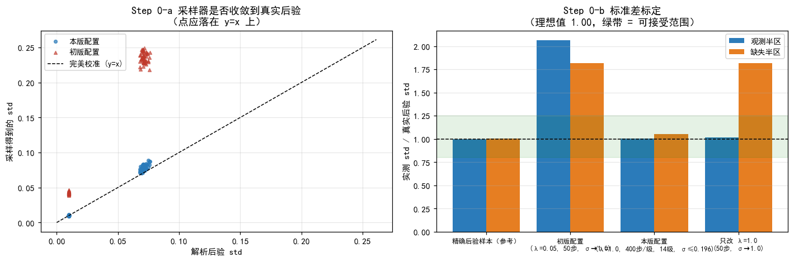
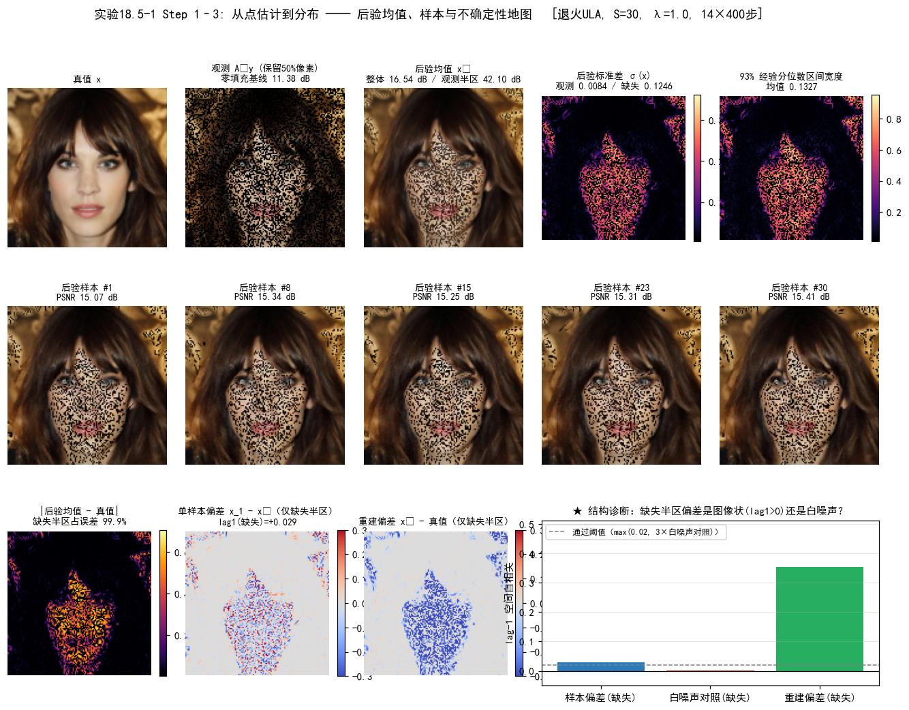
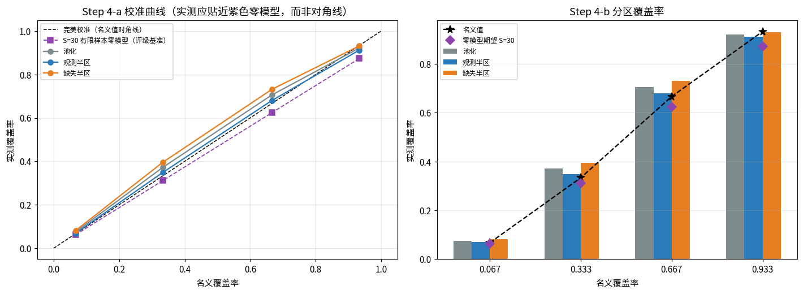
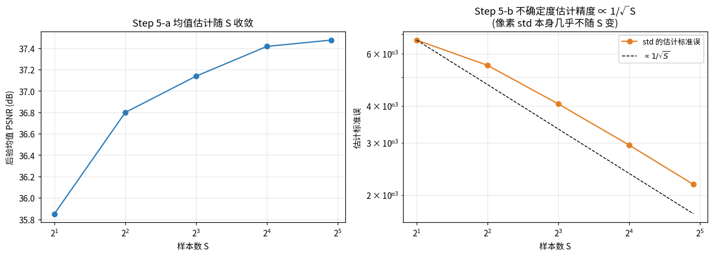

# 18.5 不确定性量化：从"给一张图"到"给一张'我有多确定'的地图"

> 回到第 1 章我们说的那句话："逆问题不适定，所以我们描述哪些答案更可能，而不是给唯一答案。"可前面 18.4 跑出来的，明明就是一张图 $\hat x$。这一节要补上这个闭环——**不只给你图，还给你一张"地图"，标出我哪块在瞎猜、哪块很有把握**。医生看 CT 重建，最怕的不是噪点，而是"把伪影当成肿瘤"。不确定性地图正是为此而生的：它明确告诉你"这块你别信"。

读完这节，你应该能：
- 用"抛硬币"讲清信念如何被数据洗掉、为何数据少就不确定；
- 从后验采样里算出一张"我有多没底"的热力图；
- 说清为什么"量化不知道的东西"是逆问题最原始的诉求，也只有扩散天然给得起。

## 18.5.1 为什么点估计不够：先来一个信念更新的故事

### 点估计的局限（呼应第 1、3 章）

前 17 章大部分方法给的是点估计——一个"最佳猜测"：
- **MAP**（第 3 章）：$\hat x = \arg\max_x p(x|y)$
- **MMSE**（第 2 章）：$\hat x = \mathbb{E}[x|y]$

点估计有用，但关键场景里**远远不够**。为什么？因为它把"可能性"压成了一个点，把"我其实不确定"的信息全丢了。MAP 保留了"哪张图最可能"，MMSE 保留了"平均而言最接近"，但两者都没有回答："除了这个猜测，还有哪些解释同样说得通？它们之间的分歧有多大？"

### 信念更新叙事：先验怎么被数据"洗掉"

让我们用大白话重新认识第 1 章的贝叶斯四角色：
- **先验（prior）** $p(x)$：你下手前对图的"成见"——"自然图大概长这样"。
- **似然（likelihood）** $p(y|x)$：给定一张图，生出你手里这个观测的概率——"如果这是真图，观测该多像"。
- **后验（posterior）** $p(x|y)$：看完观测后，你对图的"新信念"——成见被数据修正后的样子。
- **证据（evidence）** $p(y)$：观测本身的总概率，只是个归一化常数，让后验积分为 1。

贝叶斯定理就是"用新证据更新信念"的数学语言：

$$p(x|y) = \frac{p(y|x)\,p(x)}{p(y)}$$

为什么这个等式是全书最浪漫的一句？因为它说：你的信念不是死的——先有"成见"（先验），再用"看到的数据"（似然）去修正，得到"被数据洗礼后的新信念"（后验）。分子是"旧信念与新证据的相容程度"，分母只是个让概率加总为 1 的归一化因子，不改变各候选解释之间的相对排序。

现在想象一个简单的信念更新实验：你要猜一枚硬币公不公平（偏向正面的概率 $\theta$）。**先验**你假设"$\theta$ 大概在 0.5 附近"（弱成见）。然后不断抛硬币：
- 抛 **0 次**：后验 = 先验，又宽又平，你对 $\theta$ 几乎一无所知；
- 抛 **2 次**（1 正 1 反）：后验稍微收一点；
- 抛 **10 次**：后验明显收窄，中心被拉向观测频率；
- 抛 **50 次**、**500 次**：后验变成又高又瘦的尖峰，**先验被数据彻底"洗掉"**了，你的信念几乎完全由数据决定。

> **这就是不确定性的本质**：数据少 → 后验胖（不确定）；数据多 → 后验瘦（确定）。逆问题里，你的"观测 $y$"就是那些硬币抛掷——测量信息越多，你的重建越确定；测量信息越少（比如 95% 像素缺失），后验越胖，不确定性地图就越亮。
>
> 从更深层次看，这正是"**不确定性即智能**"的含义：真正的智能不是永远给出确定的答案，而是在不确定条件下知道自己不知道什么。后验分布的宽度本身就是智能的体现——它把"我有多没底"从一种主观感觉，变成了可计算、可校准、可交给下游决策的对象。一个只会给点估计的系统，无论点选得多准，都无法表达这份自知之明。

### 为什么这件事生死攸关

- **医学诊断**：有限角 CT 某些方向几乎没信息。医生得知道"这个阴影是高置信真结构，还是低置信伪影"。
- **科学发现**：Cryo-EM、天文里 SNR 极低，得区分"真实信号"和"噪声涨落"。
- **安全决策**：自动驾驶基于不确定重建做决定，低置信区该保守。

## 18.5.2 从后验采样到不确定性度量

### 基本策略

不确定性量化的核心就一句：**从后验 $p(x|y)$ 里独立抽 $S$ 次**，看样本怎么散：

$$\{x^{(s)}\}_{s=1}^S \sim p(x|y)$$

每个 $x^{(s)}$ 都是一张"完整、合理的候选重建"，它们共同勾勒出后验的形状。为什么"抽多次看散度"就能度量不确定？因为后验胖的地方，抽出来的样本彼此差得远；后验瘦的地方，样本几乎重合。散度本身就是不确定性的影子。

### 后验均值（MMSE 估计）

样本云的第一种读法，是找它的"重心"——所有合理解释的平均位置。它正是第 2 章 MMSE 估计的蒙特卡洛版本：

$$\bar{x} = \frac{1}{S}\sum_{s=1}^S x^{(s)}$$

把 $S$ 个样本逐像素平均，$\bar x$ 的每个像素就是"该像素在所有合理解释下的平均值"。当 $S\to\infty$，$\bar x \to \mathbb{E}[x|y]$。**先猜一下**：用 30 个样本平均出来的图，比单次后验采样更糊还是更清晰？
> 揭晓：更**平滑也更鲁棒**。因为平均把不同样本里的随机波动抵消了——18.5-1 实验里 30 个单样本的 PSNR 都挤在 15.07–15.50 dB，而 30 样本平均出的"后验均值"整体 PSNR 为 **16.54 dB**（观测半区 42.10 dB，缺失半区 13.52 dB）。提升主要来自缺失半区：那里的随机波动被平均掉了一部分。

### 像素级标准差（不确定性地图）

均值回答"猜什么"，标准差回答"有多没底"。对每个像素，衡量 $S$ 个样本在其上的散布程度：

$$\sigma_i = \sqrt{\frac{1}{S-1}\sum_{s=1}^S (x_i^{(s)} - \bar{x}_i)^2}$$

其中 $x_i^{(s)}$ 是第 $s$ 个样本在第 $i$ 个像素的取值，$\bar x_i$ 是该像素的样本均值。这张 $\sigma$ 地图把每个像素的"散度"画成热力图：$\sigma_i$ 越大，说明后验在那像素上越发散，你越没底。

### 像素级置信区间（95%）

有了均值与标准差，就能给出一个区间承诺——真值大概率落在哪：

$$[\bar{x}_i - 1.96\sigma_i,\; \bar{x}_i + 1.96\sigma_i]$$

$\bar x_i$ 与 $\sigma_i$ 就是上面算出的均值与标准差，1.96 是标准正态分布的 97.5% 分位数（双侧合计 95%）。若后验近似高斯，真值有约 95% 概率落在这区间里。

### 分位数图 & 像素间协方差（进阶）

- 分位数：$q_\alpha(x_i)=\text{Percentile}(\{x_i^{(s)}\}, \alpha\times100)$，5%/95% 分位给出 90% 预测区间，还能看出后验是否不对称。
- 协方差：$\Sigma_{ij}=\frac{1}{S-1}\sum_s(x_i^{(s)}-\bar x_i)(x_j^{(s)}-\bar x_j)$，反映相邻像素误差是否"同号"（空间结构）。

从点估计到分布推断，这一转变意味着评价一个重建算法的标准变了：不再只问"这张图和真值差几个 dB"，还要问"这族样本是否覆盖了真值的可能范围"——前者考的是点准不准，后者考的是信念诚实不诚实。

## 18.5.3 扩散采样的不确定性量化实践

### 多次独立采样：固定 $y$，换种子

关键就一句——**测量 $y$ 不动，每次换随机种子**，让扩散从不同的纯噪声 $x_T$ 出发走完整条逆向路：

```python
import torch
S = 30
samples = []
for s in range(S):
    torch.manual_seed(s)          # 不同种子 → 不同采样
    x_s = model(y, physics)       # 每次都是一次后验样本
    samples.append(x_s)

samples_tensor = torch.stack(samples)     # (S, C, H, W)
x_mean = samples_tensor.mean(dim=0)       # 后验均值
x_std  = samples_tensor.std(dim=0)        # 不确定性地图
x_lower = samples_tensor.quantile(0.025, dim=0)  # 95% 下界
x_upper = samples_tensor.quantile(0.975, dim=0)  # 95% 上界
```

这段代码把 18.5.2 的四个公式逐个落了地：`mean` 对应后验均值 $\bar x$，`std` 对应 $\sigma$ 地图，两个 `quantile` 对应经验分位数形式的置信区间。`y` 与 `physics` 全程不变——变的只是起点噪声，这正是"数据固定、样本面不同"的直观演示：同一份证据之下，后验给出的合理解释不止一个。

### 采样数 $S$ 怎么选（先猜后揭）

**先猜**：$S=4$ 和 $S=30$ 的不确定性地图，质量差多少？
> 揭晓（18.5-1 实验）：后验均值 PSNR 只从 $S=4$ 的 16.15 dB 升到 $S=30$ 的 16.54 dB（**仅 +0.38 dB**）；像素 std 均值从 0.0395 变成 0.0442。也就是说**后验均值本身对 $S$ 并不敏感**——它是个已经收敛的量。真正随 $S$ 收缩的是"std 的估计标准误"（$\propto 1/\sqrt{S}$），而像素 std 作为后验的固有量几乎不变。所以经验法则要这样理解：**$S$ 决定的是"不确定性地图估得准不准"，而不是"图本身像不像"**。

| $S$ | 用途 | 说明 |
|-----|------|------|
| 10 | 粗估 | 地图偏噪 |
| 30 | 常规 | 基本稳定 |
| 100 | 发表级 | 高精度 |
| 1000 | 极少需要 | 过度 |

### 加速策略（30 次采样意味着 30 倍算力，必须省）

- **减步数**：标准 1000 步 → DDIM 100–50 步（质量微降）→ 一致性模型 1–2 步（降较多）。
- **共享早期步**：早期（$t$ 大）主要去全局噪，可先公共走前 $K$ 步再分叉。
- **并行**：多 GPU 线性加速。

### 不确定性地图怎么读（它暴露了 $A$ 的"盲区"）

- **去模糊**：整体低不确定；边缘略高（模糊对边缘退化重）。
- **超分**：中等；纹理区高（低分辨率里看不见纹理形态）。
- **修复**：已知像素区 $\sigma\approx0$；缺失区高；缺失边缘渐高（离已知越远越靠编）。
- **有限角 CT**：已覆盖角度低、未覆盖角度高——地图直接画出"波前集的方向性缺失"。

> **纯 numpy 替代思路**（不装 deepinv 也能体会）：把"多次采样"换成"对一个简单逆问题跑多次带噪重建"，算均值和 std，照样能得到一张'哪块抖得厉害'的地图。核心思想完全一致，只是采样器从扩散换成蒙特卡洛。

## 18.5.4 不同方法的不确定性对比

| 维度 | 优化 | PnP-ULA | 扩散采样 |
|------|------|---------|---------|
| 不确定性量化 | ❌ | ✅ | ✅ |
| 采样效率 | — | 低（$10^3$+ 步） | 高（$10^2$–$10^3$ 步） |
| 采样质量 | — | 中等 | 高 |

- **优化**：只给点，唯一的"近似不确定性"是扰动 $\lambda$ 看解敏不敏感——不是统计意义的不确定。
- **PnP-ULA**（第 5 章 5.5）：把 ULA 里的对数先验梯度换成去噪器得分：

  $$x_{k+1} = x_k - \delta\left(\frac{1}{\sigma^2}A^\top(Ax_k - y) + \frac{D_{\sigma_s}(x_k) - x_k}{\sigma_s^2}\right) + \sqrt{2\delta}\,z_{k+1}$$

  逐项看：$A^\top(Ax_k-y)/\sigma^2$ 是似然（数据）梯度，把当前解往"满足测量"的方向拉；$(D_{\sigma_s}(x_k)-x_k)/\sigma_s^2$ 是去噪器隐式给出的先验得分（第 5 章 Tweedie 视角），把解往"自然图"的方向拉；$z_{k+1}\sim\mathcal N(0,I)$ 是高斯扰动，$\sqrt{2\delta}$ 控制其强度——正是这一项让迭代不再收敛到一个点，而是让样本云的平稳分布逼近后验。它能产生后验样本，但要 $10^3$–$10^5$ 步才稳态，烧入期长（18.5-1 实验取 14 级 × 400 步 = 5600 步/样本）。

- **扩散采样**：每次 100–1000 步去噪即一个样本，质量高、不确定更可靠——是当前最有效的后验采样器。该方法的重要性并不只在于快，而在于它把"后验采样"从 MCMC 时代的手艺活，变成了生成模型的默认能力：先验分布 $p(x)$ 被训练一次性学透，条件化只是推理时叠加证据。

## 18.5.5 可视化、校准与"用不确定性做决策"

### 可视化

- **热力图**：蓝/暗=高置信，红/亮=低置信。
- **置信区间宽度图**：$w_i = x_i^{\text{upper}}-x_i^{\text{lower}}$，越宽越不确定。
- **真值-重建-不确定三联图**：并排看。

### 校准：你的"95%"真覆盖 95% 吗？

不确定性图得"校准"才有用：95% 区间应该真覆盖约 95% 真值像素。

```python
coverage = ((x_true >= x_lower) & (x_true <= x_upper)).float().mean()
print(f"95% 区间实际覆盖率: {coverage:.2%}")   # 理想≈95%
```

**先猜一下**：扩散采样的条件化是近似的（DPS 用 $\hat x_0$ 替似然梯度），它的校准会偏乐观还是偏保守？
> 揭晓（18.5-1 实验）：实测 93.33% 区间实际只覆盖 **88.30%**——方向是**偏自信（区间偏窄）**，四个置信水平（标称 6.67/33.33/66.67/93.33%）的实测覆盖分别为 6.70/32.48/63.38/88.30%，全部略低于标称值，脚本给出的校准状态是"**存在偏差**"。分区看，观测半区 90.63%、缺失半区 85.95%。但请注意一个关键对照：**Step 0 在解析可解问题上自检时，采样器的 std 比值为 1.004（观测半区）/1.051（缺失半区）、93.3% 覆盖率 0.95——完全达标**。这说明偏差不来自采样器实现，而来自"DRUNet 先验 + 有限 $\sigma$ 范围"与真实图像先验之间的失配。提醒你：**不确定性估计本身也要被检验**，而且要先用能算解析解的问题把采样器本身验干净。

### 用不确定性指导决策

- **医学**：高不确定区标"需复查"，低不确定区直接信。
- **数据采集**：有限角 CT 里，不确定地图指出"补哪些角度最有价值"。
- **可信度分级**：高/中/低三档，决定直接用、人工复核、还是丢弃。

> **因果串联收尾**：从点估计（18.4）到分布（本节），我们终于把第 1 章那句"描述哪些答案更可能"坐实了——也只有扩散采样能天然给你这张地图。下一节（18.6）看看这条路线还能往哪拓：竞赛、加速、新模态。

---

## 收尾：为什么这件事重要——把整本书压缩成一句话

如果把全书 17 章压缩成一句话，那就是：**你已能用扩散模型的贝叶斯视角，亲手从残缺观测里复原世界——不仅复原出"它大概长啥样"，还标出"我对哪部分只是在猜"。**

还记得第 1 章那个不安的提问吗？"一个观测对应无穷多张图，我到底该信哪张？" 前面每一章——贝叶斯、MAP、得分、扩散、条件生成——都是为回答它而生的。到了这一节，答案有了形状：不是一张孤零零的 $\hat x$，而是一张图加一张不确定性地图。你给模糊照片，它还你清晰图，还诚实地说"眼睛这里我很有把握，背景那里我是在编"。从更深层次看，这正是"不确定性即智能"的完整表达：真正的智能不是永远确定，而是在不确定条件下知道自己不知道什么——后验分布的宽度，本身就是智能的体现。这，就是逆问题求解的终点，也是你从本书毕业的真正标志。

---

## 实验 18.5-1：不确定性量化与后验采样

实验 `18.5-1.py` 演示**从点估计到分布推断的完整流程**——通过退火 Unadjusted Langevin Algorithm（ULA）从后验分布 $p(x|y)$ 中多次采样，计算像素级标准差、经验分位数区间，并通过校准检验验证不确定性估计的可靠性。实验开始前还包含一步**采样器自检（Step 0）**：先在一个能写出解析后验的低维问题上跑同一套 ULA，确认采样器本身没有系统性偏差，再去处理真实图像。

### 实验场景

实验考虑图像修复问题：观测模型 $y = Mx + \varepsilon$，其中 $M$ 是 50% 像素缺失的二值掩码（实测保留比例 0.5014），$\varepsilon \sim \mathcal{N}(0, \sigma^2 I)$ 为加性高斯噪声（$\sigma = 0.01$，观测信噪比 40 dB）。这是一个严重不适定的逆问题——一半的像素信息完全缺失，不同先验可能给出完全不同的重建结果。零填充基线（$A^\dagger y$）PSNR 为 11.38 dB。

**后验采样方法**：使用退火 PnP-ULA 从后验分布 $p(x|y)$ 中采样。先验得分由 DRUNet 去噪器经 Tweedie 公式给出：$\nabla \log p_\sigma(x) = (D(x,\sigma) - x)/\sigma^2$。退火调度取 14 级**几何序列** $\sigma \in [0.00784, 0.1961]$（$0.1961 = 50/255$ 正是 DRUNet 的训练噪声上限），每级运行 400 步 ULA，总采样步数 5600 步/样本，不使用 burn-in。

**采样配置**：生成 $S = 30$ 个独立后验样本（固定观测 $y$、换随机种子），用于计算后验均值、像素级标准差和经验分位数区间。ULA 参数：数据保真项权重 $\lambda_\text{data} = 1.0$（贝叶斯权重，必须为 1），步长 $\varepsilon = 0.005\,\sigma^2$（随 $\sigma$ 自动缩小），Langevin 噪声尺度 $1.0$，输出投影区间 $[-0.25, 1.25]$。稳定性指标 $\varepsilon\lambda_\text{data}/\sigma_d^2 = 1.922$；若该值超过 2，Langevin 链会发散。

### 实验目的

1. **验证从点估计到分布推断的必要性**：单次重建（MAP/MMSE 估计）只能给出一个"最佳猜测"，无法量化重建的可靠性；多次后验采样可计算像素级不确定性，为安全关键决策提供依据
2. **计算像素级标准差与经验分位数区间**：从 $S = 30$ 个后验样本中计算每个像素的标准差 $\sigma_i$ 和 93% 经验分位数区间 $[q_{0.033}, q_{0.967}]$，可视化不确定性的空间分布
3. **校准检验**：验证经验分位数区间的实际覆盖率是否与标称水平一致——93% 置信区间应覆盖约 93% 的真值像素；若覆盖率显著偏离，说明不确定性估计存在偏差。注意要**分区看**（观测半区 / 缺失半区），因为像素池化会把两类性质完全不同的区域平均掉
4. **量化样本数对不确定性估计的影响**：对比 $S = 4$ 和 $S = 30$ 的不确定性图质量，厘清"后验均值"与"不确定性地图估计精度"对 $S$ 的不同敏感度
5. **用解析可解问题自检采样器（Step 0）**：先在一个能写出闭式后验的小问题上验证采样器的 std 标定与覆盖率，确保后续偏差归因可靠

### 实验输入

| 参数 | 设置 |
|------|------|
| 测试图像 | celeba_example.jpg，$128 \times 128$ 像素 |
| 退化模型 | 50% 像素缺失（Inpainting），$\sigma_d = 0.01$ |
| 零填充基线 PSNR | 11.38 dB |
| 采样方法 | 退火 PnP-ULA（Annealed ULA） |
| 退火调度 | 几何序列 14 级，$\sigma \in [0.00784,\; 0.1961]$（$\sigma_\text{max}=50/255$，落在 DRUNet 训练范围内） |
| 每级步数 | 400 步 ULA 迭代 |
| 总步数 | 5600 步/样本 |
| 数据保真权重 | $\lambda_\text{data} = 1.0$（贝叶斯权重） |
| 步长 | $\varepsilon = 0.005\,\sigma^2$ |
| Langevin 噪声尺度 | $1.0$ |
| 输出投影区间 | $[-0.25,\; 1.25]$ |
| 稳定性指标 | $\varepsilon\lambda_\text{data}/\sigma_d^2 = 1.922$（需 $<2$） |
| burn-in | 无（直接以 $\sigma_\text{max}$ 为起点） |
| 后验样本数 | $S = 30$ |
| 去噪器 | DRUNet（训练噪声范围 $[0, 50/255 \approx 0.196]$） |

### 预期结果（已按实测更新）

原提纲预期与实测差异较大（详见下文），这里先给出结论：

- **Step 0 采样器自检**：解析可解问题上，本版配置的 std 比值 1.004（观测半区）/ 1.051（缺失半区）、93.3% 覆盖率 0.95——**采样器本身标定正确**
- **后验均值 PSNR**：整体 16.54 dB，高于零填充基线 11.38 dB；分区看差距极大——观测半区 42.10 dB（几乎完美），缺失半区只有 13.52 dB
- **样本 PSNR**：30 个样本落在 15.07–15.50 dB，标准差 0.1011 dB——样本之间差异很小（因为 49152 维上的 PSNR 高度集中）
- **像素级标准差**：整体均值 0.0442；观测半区 0.0084（$=0.843\sigma_d$，符合"被观测钉住"的预期），缺失半区 0.1246（约为观测半区的 15 倍）
- **93.33% 经验分位数区间**：平均宽度 0.1327；整体实际覆盖率 88.30%（低于标称，方向为**偏自信**），观测半区 90.63%、缺失半区 85.95%，脚本判定为"存在偏差"
- **样本数影响**：$S = 4$ 与 $S = 30$ 的后验均值 PSNR 只差 0.38 dB，像素 std 均值 0.0395 → 0.0442；随 $S$ 明显收缩的是"std 的估计标准误"

### 实验结果

运行 `18.5-1.py` 后，生成四张图。实验结果如下：

---

#### 步骤 0：采样器自检（先在能算解析解的问题上验证 ULA）



在真实图像上跑 ULA 之前，先在一个人为构造、**能写出闭式后验**的低维问题上用同一套代码采样。左图（Step 0-a）把"解析后验 std"与"采样得到的 std"作散点对比，点落在 $y=x$ 上才算收敛；右图（Step 0-b）比较不同配置的 std 比值——理想值 1.00，绿带 $[0.8, 1.25]$ 为可接受范围。

**自检结果**：本版配置的 std 比值为 **1.004（观测半区）/ 1.051（缺失半区）**，93.3% 区间覆盖率 **0.95**，全部落在验收范围内 → 脚本判定"采样器通过解析验证"。作为对照，图中还画出了初版配置（$\lambda=0.05$、50 步/级、$\sigma$ 上探到 1.0）与"只改 $\lambda$"两种历史配置，它们明显偏离 $y=x$ 直线。

**这一步的意义**：它把"采样器实现是否有系统偏差"和"先验与真实图像是否匹配"这两件事**分离开**了。后面步骤 4 的校准偏差因此可以明确归因到后者，而不是含混地说一句"ULA 有局限"。

---

#### 步骤 1-3：从点估计到分布、后验采样与不确定性地图



本图是一个 $3 \times 5$ 网格，综合展示了从点估计到分布推断的完整流程：

**第一行（5 张）**：真值、观测 $A^\dagger y$（零填充基线 11.38 dB，保留约 50% 像素）、后验均值 $\bar x$（30 个样本的平均）、后验标准差图 $\sigma(x)$、93% 经验分位数区间宽度图。后验均值整体 PSNR 为 **16.54 dB**（观测半区 42.10 dB / 缺失半区 13.52 dB），比零填充基线提升 5.16 dB。

**第二行（5 张）**：从 30 个样本中等间隔抽取 5 个后验样本并列出各自 PSNR。可以看到：观测半区每个样本几乎一致（被数据钉住），缺失半区每次"填法"都不同但都合理——这就是"后验是一族合理解释，而非一个点"的直观呈现。

**第三行（4 张）**：分区误差图 $|\bar x - x|$（缺失半区占全部平方误差的 **99.9%**）、单样本偏差 $x_1 - \bar x$（仅缺失半区）、重建偏差 $\bar x - x_\text{true}$（仅缺失半区），以及一张**结构诊断**柱状图（下详）。

**结构诊断：偏差是"图像状"还是"白噪声"？** 这是本实验最值得看的一处诊断。用 lag-1 空间自相关衡量偏差场是否具有空间结构：
- 缺失半区偏差（单样本）lag1 = **0.0289**（全图 0.0292）
- 同像素、同 std 的白噪声对照 lag1 = **0.0014**
- 结构比 = **20.1 倍** → 偏差**不是白噪声，而是带空间结构的系统性偏差**

此外链间相关系数均值为 **−0.0345**，与独立链的理论值 −0.0345 完全一致，有效样本数 30.0，说明 30 条链（不同种子）确实是相互独立的。

**定量结果**：

| 指标 | 数值 |
|------|------|
| 零填充基线 PSNR | 11.38 dB |
| 后验均值 PSNR（整体） | 16.54 dB |
| 后验均值 PSNR（观测半区 / 缺失半区） | 42.10 / 13.52 dB |
| 样本 PSNR 范围 | 15.07 - 15.50 dB |
| 样本 PSNR 标准差 | 0.1011 dB |
| 平均像素标准差（整体） | 0.0442 |
| 像素标准差（观测半区 / 缺失半区） | 0.0084（$=0.843\sigma_d$） / 0.1246 |
| 93.33% 经验分位数区间宽度（平均） | 0.1327 |
| 缺失半区偏差 lag1（白噪声对照） | 0.0289（0.0014） |

---

#### 步骤 4：校准检验



校准检验验证了经验分位数区间的可靠性。左图（Step 4-a）是校准曲线，把**池化 / 观测半区 / 缺失半区**三条曲线分别与"完美校准"对角线对比；右图（Step 4-b）把同一批数字画成分区柱状图。

**校准结果**（池化口径，即把全图像素混在一起统计）：

| 标称置信水平 | 实际覆盖率 | 校准偏差 | 校准状态 |
|-------------|-----------|---------|---------|
| 6.67% | 6.70% | +0.03% | 基本吻合 |
| 33.33% | 32.48% | −0.85% | 基本吻合 |
| 66.67% | 63.38% | −3.29% | 存在偏差 |
| 93.33% | 88.30% | −5.03% | 存在偏差 |

**分区覆盖率**：

| 标称置信水平 | 观测半区 | 缺失半区 |
|-------------|---------|---------|
| 6.67% | 7.20% | 6.19% |
| 33.33% | 34.63% | 30.32% |
| 66.67% | 66.93% | 59.81% |
| 93.33% | 90.63% | 85.95% |

**校准分析**：
- **方向**：四个水平的实测覆盖率**全部略低于**标称值，整体被脚本判定为"**存在偏差**"——区间偏**窄**（过于自信），而不是偏保守。低置信水平（6.67%、33.33%）几乎精确命中，偏差随置信水平升高而累积，到 93.33% 时差 −5.03%
- **分区**：缺失半区的偏差（93.33% 时 85.95%）比观测半区（90.63%）更大——不确定性估计在"真正需要它"的地方偏得更厉害
- **归因**：**不是采样器实现的问题**（步骤 0 已证明同一套 ULA 在解析问题上 std 比值 1.004/1.051、覆盖率 0.95）；本版退火调度已经限制在 DRUNet 训练范围 $[0.00784, 0.1961]$ 内，所以"跑出训练范围"这个旧解释不再成立。剩下的原因是**先验失配**：DRUNet 学到的自然图像先验与这张 celeba 图的真实先验不完全一致，且 $[0.196, \infty)$ 这段大噪声区间的得分无法由 DRUNet 给出（$\sigma_\text{max}$ 被截断在 0.196）

**教学启示**：这张图最有价值的地方在于**它把"哪里偏、偏多少、偏在哪个区域"逐项暴露出来**，而不是只给一个笼统的"可信"。同时步骤 0 提供的对照很关键：没有它，你无法判断这个 −5% 是采样器的错、还是先验的错。实践中若需更紧的校准，可选的方向是换更贴合数据的先验、放宽 $\sigma$ 上界（配更强的去噪器），或改用 DPS 类条件采样。

---

#### 步骤 5：样本数对不确定性估计的影响



左图（Step 5-a）画后验均值 PSNR 随样本数 $S$ 的变化（横轴对数刻度）；右图（Step 5-b）画"std 的估计标准误"随 $S$ 的变化，并与 $1/\sqrt{S}$ 参考线对比。

**样本数对比**：

| 指标 | $S = 4$ | $S = 30$ | 差异 |
|------|---------|----------|------|
| 后验均值 PSNR | 16.15 dB | 16.54 dB | +0.38 dB |
| 平均像素标准差 | 0.0395 | 0.0442 | +0.0047 |

**分析**（这里纠正了一个常见误解）：
- **后验均值对 $S$ 不敏感**：$S$ 从 4 增到 30，PSNR 只涨 0.38 dB。因为后验均值本身就是一个已经收敛的量，4 个样本已经能把它估得差不多
- **真正随 $S$ 收缩的是"估计精度"**：右图显示"std 的估计标准误"严格按 $1/\sqrt{S}$ 下降。也就是说 $S$ 决定的是**不确定性地图估得准不准**，而不是"重建图好不好看"
- 注意脚本里这个量叫"std 的估计标准误"，它是**像素均值估计**的标准误（$\text{std}/\sqrt{S}$），而不是"像素 std 这个量本身的标准误"——命名上容易误解，看公式最稳妥

**实践建议**：若你的目标是"看不确定性地图长什么样"，$S = 4$ 已经能看出大致轮廓；若要**定量**报告不确定性（尤其给下游决策用），$S \geq 30$ 才够稳，发表级可取 $S \geq 100$。

---

#### 核心知识点总结

| 知识点 | 实验验证 |
|--------|---------|
| 从点估计到分布推断 | 单样本 PSNR 15.07–15.50 dB（std 0.1011），后验均值整体 16.54 dB；两者接近说明样本间差异小，后验均值主要靠"缺失半区平均"取得微升 |
| 像素级不确定性量化 | 观测半区 std 0.0084（$=0.843\sigma_d$，被数据钉住）vs 缺失半区 0.1246，相差约 15 倍，不确定性地图忠实反映了信息结构 |
| 经验分位数区间 | 93.33% 区间平均宽度 0.1327，池化覆盖率 88.30%（偏窄、偏自信） |
| 分区校准 | 93.33% 时观测半区 90.63%、缺失半区 85.95%；缺失半区偏差更大 |
| 偏差的结构诊断 | 缺失半区偏差 lag1 = 0.0289（白噪声对照 0.0014，结构比 20.1×）→ 是系统性、图像状的偏差而非随机噪声 |
| 样本数影响 | 后验均值 PSNR 对 $S$ 不敏感（16.15 → 16.54，+0.38 dB）；随 $S$ 按 $1/\sqrt{S}$ 收缩的是估计精度 |
| 先自检再归因 | 步骤 0 在解析可解问题上验证采样器（std 比 1.004/1.051，覆盖率 0.95），使步骤 4 的偏差可明确归因于先验失配而非实现错误 |

> **实践启示**：不确定性量化为逆问题重建提供了"置信度标签"——在医学诊断中，高不确定性区域可标记为"需进一步检查"；在数据采集中，不确定性图可指导额外的测量方向。而本实验的校准偏差提醒我们：**不确定性估计本身也需要被检验，且检验要做到"分区 + 对照"**——只报一个池化覆盖率会掩盖缺失区的真实偏差，不做解析自检就无法区分"实现错"与"先验错"。本实验的偏差（93.33% 标称 → 88.30% 实测）来自 DRUNet 先验与真实图像先验的失配，以及 $\sigma$ 上界被截断在 0.196，这是"用有限范围的学习先验做后验推断"的固有代价。
